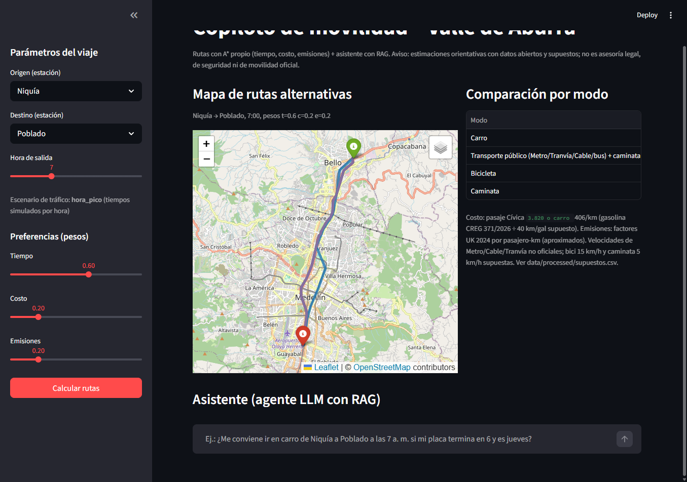

# Copiloto de movilidad – Valle de Aburrá (SI3003, proyecto 3.2)

Proyecto final de **SI3003 Inteligencia Artificial (EAFIT, 2026-1)**. Un usuario elige origen, destino,
hora y preferencias (tiempo, costo, emisiones) y el sistema compara **carro, transporte público
(Metro/Tranvía/Metrocable/bus), bicicleta y caminata** en el Valle de Aburrá. Un agente LLM con RAG
responde dudas sobre pico y placa, tarifas y reglas del Metro, y planea rutas con nuestro A\*.

- **Parte 1 (técnica clásica):** A\* propio con costo multiobjetivo y heurística consistente,
  comparado contra Dijkstra (UCS) y BFS propios en nodos expandidos, tiempo y costo.
- **Parte 2 (IA moderna):** agente con loop manual (T_max = 6), 2 herramientas (`plan_route`,
  `search_docs`), RAG con embeddings + FAISS, citas de fuente, endpoint gratuito de Groq.
- **Dashboard (Streamlit):** mapa con rutas alternativas, tabla comparativa, parámetros y chat.

> **Aviso:** estimaciones orientativas con datos abiertos y supuestos declarados. Nada de este
> proyecto es asesoría legal, médica, de seguridad ni de movilidad oficial.



## 1. Instalación

Requisitos: Python 3.11 y conexión a internet **solo la primera vez** (descarga de librerías y del
modelo de embeddings, ~500 MB). Todo lo demás corre offline con `data/processed/`.

```bash
git clone <URL-del-repo> && cd <carpeta-del-repo>
python -m venv .venv
# Windows: .venv\Scripts\activate      Linux/macOS: source .venv/bin/activate
pip install -r requirements.txt
```

## 2. Variables de entorno

```bash
cp .env.example .env        # Windows: copy .env.example .env
```

Edite `.env` y ponga su clave gratuita de Groq (https://console.groq.com/keys):

| Variable | Obligatoria | Valor por defecto | Uso |
|---|---|---|---|
| `GROQ_API_KEY` | Sí (solo para el chat) | – | Clave del endpoint compatible con OpenAI |
| `GROQ_MODEL` | No | `openai/gpt-oss-120b` | Modelo con tool calling |

La clave **nunca** está en el código. Sin clave, la app funciona (mapa y tabla) y el chat muestra un
mensaje claro.

## 3. Correr la app

```bash
streamlit run app/app.py
```

Se abre en http://localhost:8501. **La primera ejecución tarda 1-2 min** (descomprime el grafo vial,
lo guarda en `data/cache/` y descarga el modelo de embeddings); las siguientes cargan en segundos.

Uso: elija origen, destino, hora y pesos en la barra lateral → **Calcular rutas**. Abajo, escriba
al asistente (p. ej. *"Mi placa termina en 6 y es jueves, ¿puedo ir en carro de Niquía a Poblado a
las 7 a. m.?"*). Si el agente calcula rutas, el mapa y la tabla se actualizan con ellas.

## 4. Reproducir la evaluación de A\* (Parte 1)

```bash
python -m eval.search_eval
```

~20 s. 20 pares origen-destino fijos (10 entre estaciones + 10 aleatorios, semilla 42), hora 8,
pesos iguales, perfiles carro y transporte. Salidas: `eval/results/search_results.csv` (detalle) y
`eval/results/search_summary.md` (resumen). networkx se usa **solo para validar** que el costo
hallado es óptimo.

Resultado obtenido (promedios por par):

| Perfil | Algoritmo | Nodos expandidos | Tiempo (ms) | Costo generalizado | Óptimo (de 20) |
|---|---|---|---|---|---|
| carro | A\* | 5.995 | 32 | 18,8 | 20 |
| carro | Dijkstra | 18.571 | 54-60 | 18,8 | 20 |
| carro | BFS | 15.076 | 20 | 21,5 | 0 |
| transporte | A\* | 4.401 | 22-24 | 16,8 | 20 |
| transporte | Dijkstra | 9.922 | 30-34 | 16,8 | 20 |
| transporte | BFS | 7.895 | 11-13 | 19,9 | 10 |

Los tiempos en ms varían entre ejecuciones; los nodos expandidos y los costos son deterministas.

## 5. Reproducir la evaluación del agente (Parte 2)

```bash
python -m eval.agent_eval
```

Requiere `GROQ_API_KEY`. ~2-3 min. Corre las 13 preguntas fijas de `eval/questions.json` y registra
por pregunta: herramientas esperadas vs. llamadas (¿correcta?), si citó la fuente, errores de
herramienta e iteraciones. Salidas: `eval/results/agent_results.csv` y `eval/results/agent_summary.md`.
Como el LLM no es determinista, los resultados pueden variar un poco entre ejecuciones.

## 6. Estructura

| Ruta | Contenido |
|---|---|
| `app/app.py` | Dashboard Streamlit (mapa, tabla, parámetros, chat) |
| `src/data/loader.py` | Lectura de `data/processed` y de los supuestos |
| `src/data/network.py` | Grafo multimodal (carro, transporte, bici, caminata) como listas de adyacencia propias |
| `src/data/process_afluencia.py`, `make_corpus_docs.py` | Procesan la afluencia del Metro y generan los documentos 07 y 08 del corpus |
| `src/search/algorithms.py` | **A\*, Dijkstra y BFS propios**, costo multiobjetivo y heurística |
| `src/search/planner.py` | `plan_route` / `compare_modes` (interfaz usada por la app y el agente) |
| `src/rag/retriever.py` | Chunking por sección, embeddings, índice FAISS, `search_docs` |
| `src/agent/tools.py`, `agent.py` | Esquemas y ejecución de herramientas; loop agéntico con T_max |
| `eval/` | `search_eval.py`, `agent_eval.py`, `questions.json`, `results/` |
| `data/processed/` | Datos listos para usar (ver sección 7) |
| `data/corpus_rag/` | 8 documentos del RAG, cada uno con fuente y estado de verificación |
| `data/raw/` | Afluencia del Metro (CSV original) y PDFs oficiales (Reglamento del Metro, condiciones Bici, Circular CREG 371/2026) |
| `scripts/` | Regeneración opcional de los datos desde OpenStreetMap |
| `docs/` | Informe (`informe.md`), guion del video (`guion_demo.md`), capturas |
| `AI_USAGE.md` | Declaración de uso de IA generativa |

## 7. Fuentes de datos

Detalle completo y nivel de verificación de cada dato en [`data/FUENTES.md`](data/FUENTES.md).

| Dato | Fuente | Tipo |
|---|---|---|
| Red vial (43.507 nodos, 95.511 aristas; 6 municipios) | OpenStreetMap vía Overpass/OSMnx, © colaboradores de OSM, ODbL | Real |
| Estaciones, paradas y rutas de Metro, Tranvía, Metrocable, Metroplús y buses integrados | OpenStreetMap (ODbL) | Real (incompleto, ver limitaciones) |
| Afluencia horaria por línea, ene-jul 2026 | [Datos abiertos Metro de Medellín](https://datosabiertos-metrodemedellin.opendata.arcgis.com/) | Real |
| Precio gasolina Medellín $16.251/gal (1-nov-2026) | CREG, Circular 371 de 2026 | Oficial |
| Pico y placa 2026-2 | Alcaldía de Medellín + prensa (Caracol, El Espectador, El Tiempo) | Oficial + prensa |
| Tarifas Metro 2026 (Cívica $3.820) | Prensa (Publimetro, El Tiempo) | Prensa |
| Reglamento del Usuario (Res. 263/2019), condiciones Bici | Metro de Medellín (PDF) | Oficial |
| Factores de velocidad por hora (0,44 día / 0,338 pico) | Calibrados con TomTom Traffic Index 2025 (prensa) | **Simulado** (plan B del enunciado) |
| Factores de emisión por pasajero-km | UK GHG Conversion Factors 2024 (vía Climatiq) y analogías | Aproximado |
| Velocidades Metro 37 / Tranvía 15 / Cable 19 km/h, intervalo Línea A en punta 170 s | Fuentes no oficiales (CIDEU, ALAMYS, LA FM, mapa-metro) | No oficial |
| Bici 15 km/h, caminata 5 km/h, transbordo 180 s, rendimiento carro 40 km/gal, intervalos de valle | Supuestos del equipo | **Supuesto** |

Todos los parámetros del modelo están en `data/processed/supuestos.csv` con su tipo
(CITADO / PRENSA / NO_OFICIAL / DERIVADO / SUPUESTO).

**Regenerar los datos (opcional, no necesario):** `python scripts/01_osm_transit.py`,
`python scripts/02_osm_road_network.py` (~8 min, depende de Overpass) y
`python scripts/03_calibrate_speed_factors.py`; requieren `curl`. Tras `02`, comprimir
`data/processed/road_drive.graphml` a `.gz`.

## 8. Limitaciones

- **Sin tráfico en tiempo real:** tiempos de carro y bus simulados con 3 factores por periodo
  (calibrados a nivel de ciudad, no por calle). La asignación de horas a periodos es un supuesto; los
  datos de afluencia del Metro muestran picos ~1 h antes (5-7 a. m. y 4-6 p. m.).
- **Transporte público aproximado:** sin frecuencias ni horarios oficiales; velocidades no oficiales;
  tramos en vehículo en línea recta entre paradas; integración tarifaria asumida sin costo extra (el
  reglamento no fija la regla). OSM tiene Metroplús con 2 estaciones, Línea P sin paradas y buses
  incompletos.
- **Bici y caminata** usan la red vial de carros (no hay ciclorrutas ni red peatonal), a velocidad
  constante y sin pendiente.
- **Costo del carro:** solo combustible ($406/km); sin parqueadero, peajes ni desgaste. El pico y placa
  no se aplica en el planificador; lo responde el agente con el RAG.
- **Emisiones:** factores del Reino Unido y analogías; sirven para comparar modos, no para reportar huella.
- **Lugares:** origen y destino son estaciones (52); no hay geocodificación de direcciones.
- **Agente:** depende de un LLM externo no determinista; puede omitir información o citar con formato
  irregular. La primera carga del grafo tarda 1-2 min.

## 9. Licencias y atribución

- OpenStreetMap: © colaboradores de OpenStreetMap, ODbL (https://www.openstreetmap.org/copyright).
- Documentos del Metro, la Alcaldía y la CREG se citan como fuente; el texto del corpus es un resumen propio.

## 10. Uso de IA generativa

Ver [`AI_USAGE.md`](AI_USAGE.md).
